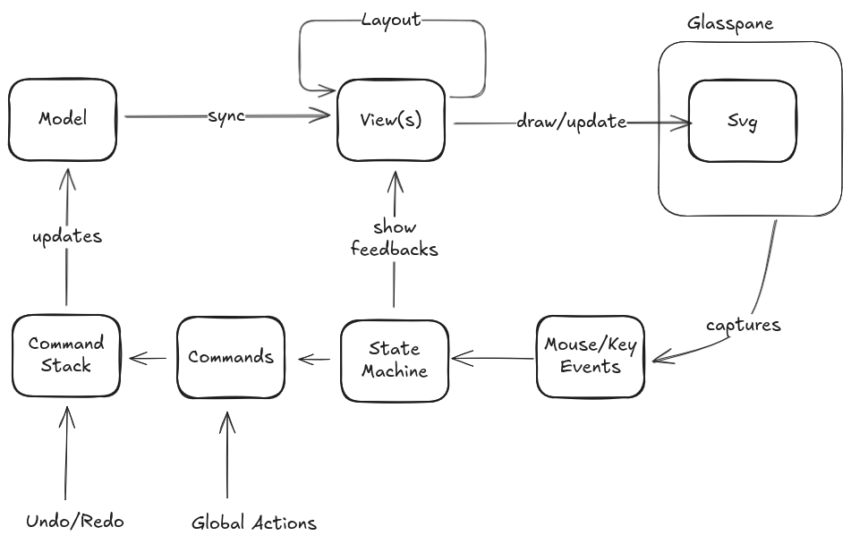

# Sequence Diagram Editor

Tutorial to build a minimalist sequence diagram editor.



# Steps

## Scaffold project

Create a vanilla web/Typescript project:

```
npm create vite@latest sequence-editor --template vanilla-ts
```

Add [svg.js](https://svgjs.dev) dependency:

```
cd sequence-editor
npm install @svgdotjs/svg.js
```

## Display

- Experiment with displaying SVG content with svg.js
- Make SVG canvas to use all screen space
- introduce the model and the view
  - first lifelines:
    - model: ordered list of named actors
    - write a static view for this model
    - how big is the head of the lifeline: measuring text
    - how to space out every elements: first simple layout
  - extract style constants
  - continue with messages: split in multiple views
    - model: ordered list of message from a lifeline to an other
    - display horizontal messages
    - long message texts can break the layout
    - tips: for testing, create a randomized model
  - property based testing of the layout:
    - lifeline headers must not overlap
    - message text must entirely between start and end lifeline

## Events Handling

- Intercept mouse events and identify concerned sub-view
- Modify views to support extra information: hover/selection/interaction points/tools
- Use layers to stack SVG elements
- Add state-machine to handle complex event sequence
- Add commands to handle model mutation
- Add a command stack to store and execute commands

## Palette

- show a palette with undo/redo and global actions
